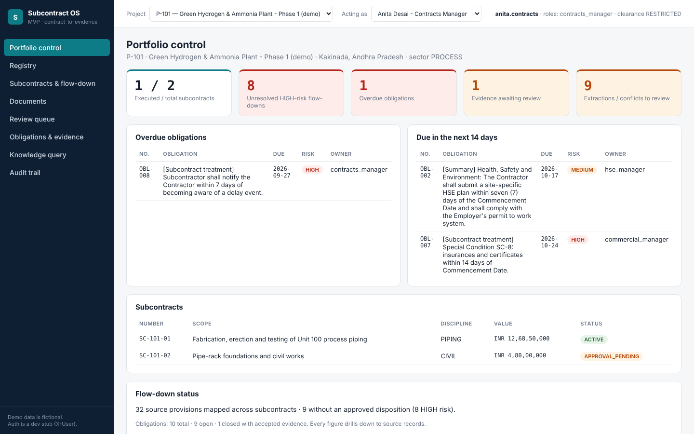
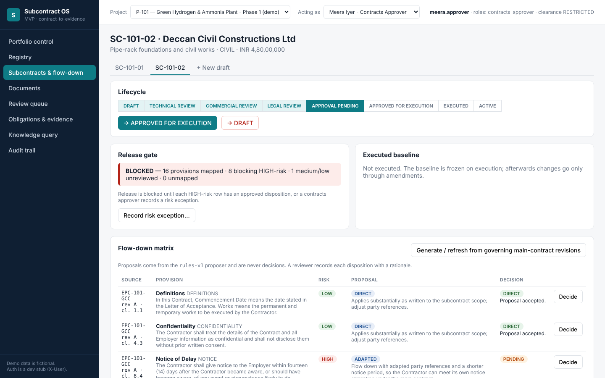
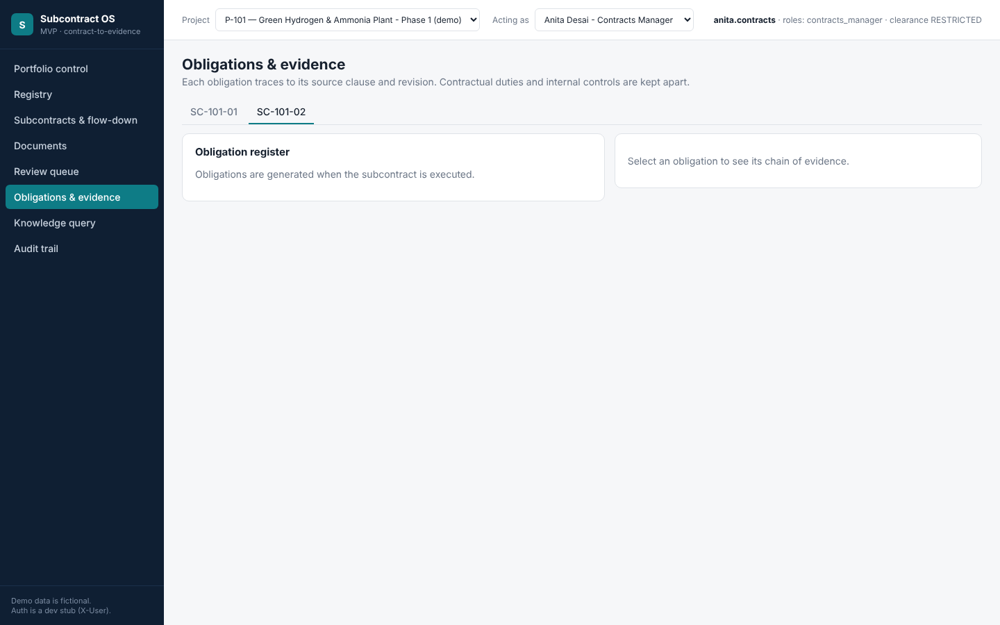
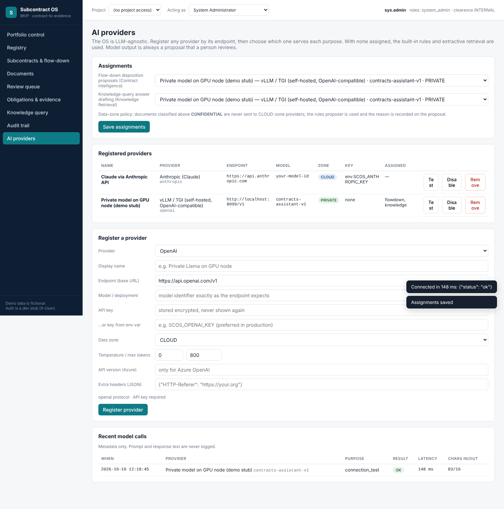

# Subcontract OS — MVP

A subcontract management system for EPC projects that is also a knowledge base. Every subcontract obligation
traces back to the exact main-contract clause and revision it came from, and forward to the evidence that closes it.

> **One subcontractor registry, multiple EPC projects, multiple project-specific subcontracts,
> one traceable chain of contractual and operational evidence.**

This MVP implements the **first vertical slice** of the
[consolidated blueprint](docs/architecture/Subcontract_OS_Consolidated_Blueprint.docx):

```
Main-contract document → source clause → proposed flow-down → human decision → release gate
   → executed baseline → obligation → evidence (review, reject / accept) → traceable closure
```



| Release gate blocking a subcontract | Obligation chain of evidence |
|---|---|
|  |  |

## What works

| Area | MVP capability | Blueprint ref |
|---|---|---|
| Registry | One legal identity per entity (duplicate detection); project-level eligibility kept separately | §4.1, Step 4 |
| Projects | Projects, main contracts, memberships with project-scoped roles | §4, §9 |
| Document ingestion | Quarantine (type, magic bytes, macros, binary text), SHA-256 object store, duplicate & revision-conflict detection, governing revision set **explicitly** | §5, Step 5 |
| Parsing | DOCX, PDF (page locators), XLSX (cell addresses + formulas + cached values), TXT/MD; clause hierarchy detection | §5.3 |
| Extraction | Notice periods (calendar/working days), percentages, amounts → review queue (accept / edit / reject); embedded-instruction flagging | §5.6, CI-08 |
| Flow-down | Matrix over governing main-contract revisions, 6 dispositions, machine proposal kept apart from human decision | §7 |
| Release gate | Unresolved HIGH-risk rows block release; risk exception only by a separate approver with a recorded reason | §7.2 |
| Lifecycle | DRAFT → … → APPROVED_FOR_EXECUTION → EXECUTED → ACTIVE state machine; segregation of duties | §8.2 |
| Baseline | Frozen on execution (documents, hashes, flow-down, value); changes only via approved amendments | CON-03, AUD-01 |
| Obligations | Generated from approved flow-down using the subcontract treatment, with source wording, trigger, period, due date and evidence required; internal controls kept apart | §6.5, Step 9 |
| Evidence | Submit → review (reviewer ≠ submitter) → reject keeps the obligation open, accept closes it; full trace endpoint | Vertical slice |
| Knowledge query | Permission-filtered, governing-revision-aware retrieval with exact clause-reference boost; contradictions, insufficient evidence and untrusted-content warnings | §6.6 |
| Governance | Append-only audit trail, typed errors, idempotency keys | §9.3, §10 |
| Dashboard | Portfolio control: unresolved flow-downs, overdue / upcoming obligations, review queue, drill-down | Blueprint §11 |

### LLM-agnostic AI layer

Any model can be plugged in from **AI providers** (system administrator): pick a provider from the dropdown
(OpenAI, Anthropic, Azure OpenAI, Gemini, Mistral, Groq, DeepSeek, OpenRouter, Together, LiteLLM gateway,
Ollama, vLLM/TGI, LM Studio or any OpenAI-compatible endpoint), enter its endpoint, model and key, test the
connection, and assign it to **flow-down proposals** and/or **knowledge answers**. Keys are encrypted and never
shown again; RESTRICTED content never leaves for a CLOUD-zone provider; model output is validated and remains a
proposal; any failure falls back to the built-in rules. See [ADR-0002](docs/adr/0002-llm-agnostic-ai-layer.md).



To try it without keys: `uvicorn seed.mock_llm:app --port 8099`, then register *vLLM / TGI* with
endpoint `http://localhost:8099/v1` and any model name.

Not in the MVP: mobilisation, field, QA/HSE registers, variations and payments (Phases 4–5), OCR for scans,
semantic (pgvector) retrieval, the enterprise identity provider, and PostgreSQL/Alembic.
See [ADR-0001](docs/adr/0001-mvp-baseline.md).

## Run it

**Windows:** double-click `start_windows.bat` (or run `.\start_windows.bat` in PowerShell). It creates a
virtual environment, installs dependencies, loads the demo and opens http://localhost:8000.

**Any OS:**

```bash
pip install -r requirements.txt reportlab
python -m seed.make_samples      # fictional pilot document pack
python -m seed.demo_seed         # loads the demo through the API (resets ./var)
uvicorn app.main:app --reload    # http://localhost:8000   API docs: /docs
```

Or `docker build -t subcontract-os . && docker run -p 8000:8000 subcontract-os`.

Use **Acting as** in the top bar to switch users and see the permissions change:

| User | Role on P-101 | Try |
|---|---|---|
| `anita.contracts` | Contracts manager (drafter) | Flow-down matrix, obligations, evidence |
| `vikram.legal` | Legal reviewer | Decide dispositions, approve governing revisions |
| `meera.approver` | Contracts approver | Approve release / risk exception (SC-101-02 is blocked at the gate) |
| `arjun.qaqc`, `sana.hse` | QA/QC, HSE | Submit evidence (CONFIDENTIAL clearance) |
| `dev.audit` | Auditor | Audit trail, traces |
| `omar.solar` | Member of P-202 only | Cross-project access is denied |

> Authentication is a development stub (`X-User` header). Authorisation is enforced in the API.
> All organisations, people and values in the demo are fictional.

## Tests

```bash
python -m pytest -q        # 50 tests: blueprint acceptance IDs + LLM-agnostic layer
```

See [docs/acceptance-traceability.md](docs/acceptance-traceability.md).

## Layout

```
app/
  models.py            authoritative relational model (logical schemas as table prefixes)
  security.py          roles, project scope, classification
  audit.py             append-only ledger, idempotency
  services/            ingestion · flowdown · lifecycle · knowledge
  llm/                 provider catalogue · gateway (5 protocols) · key encryption
  routers/             registry · contracts · documents · obligations · insight
  web/                 internal workspace (vanilla JS, no build)
seed/                  sample document generator and API-driven demo loader
tests/                 acceptance tests
docs/                  blueprint, ADRs, traceability
```

## Next steps (roadmap)

1. Confirm the ADR-0001 decisions; move to PostgreSQL + Alembic; replace the auth stub with SSO/MFA.
2. OCR for scanned contracts; email and batch intake; background worker for processing jobs.
3. pgvector semantic stage; evaluate registered models against the labelled set before assignment.
4. Phase 4–5 modules: mobilisation and enablers, field/QA/HSE, variations, measurement and payment.

Licensed under GPL-3.0 (see `LICENSE`).
